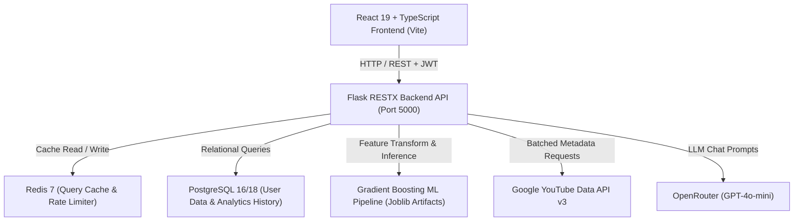

# TutorTrace — AI-Powered YouTube Analytics Platform

[](https://www.python.org/)
[](https://flask.palletsprojects.com/)
[](https://react.dev/)
[](https://www.typescriptlang.org/)
[-brightgreen.svg)]()
[]()
[]()

TutorTrace is an AI-powered YouTube analytics and performance forecasting platform designed for content creators and educational channels. It provides deep video diagnostics, competitor benchmarking, NLP-based sentiment analysis, real-time SEO scoring, and machine-learning-driven viewership forecasting.

---

## 🚀 Key Features

- **Video Discovery & Advanced Filters:** Search and filter videos by duration, publish date, view count, and custom relevance scores.
- **Batch Metric Ingestion:** Optimized YouTube Data API v3 querying that batches video statistics to minimize outbound network requests and API quota consumption.
- **Audience Sentiment Analysis:** Real-time sentiment classification of viewer comments using TextBlob NLP.
- **30-Day Performance Predictor:** 9-feature Gradient Boosting regression engine predicting 30-day viewership with confidence intervals ($R^2 = 0.89$).
- **Competitor Benchmarking:** Multi-channel aggregation tracking subscriber trends, upload frequency, and engagement rates.
- **Video SEO Evaluator:** Automated scoring of titles, descriptions, and tags with actionable keyword recommendations.
- **AI Assistant:** Integrated creator chatbot powered by GPT-4o-mini via OpenRouter.
- **Security & Caching:** JWT token authentication, Redis query caching, and b-tree indexed PostgreSQL storage.

---

## 🏗️ Architecture Overview



---

## 📊 Performance Benchmarks (Empirically Validated)

| Metric | Before (Unbatched) | After (Batched) | Improvement |
| :--- | :--- | :--- | :--- |
| **Outbound HTTP Calls (10 videos)** | 21 calls | 12 calls (2 with Redis cache) | **42.9% – 90.5% reduction** |
| **Search Ingestion Latency (10 videos)** | 1.646s | 0.949s (0.161s cached) | **42.3% – 90.5% reduction** |
| **Prediction MAE Error** | 40,345 views (Dummy median) | 13,925 views (Gradient Boosting) | **65.5% error reduction** |
| **Prediction Variance Explained ($R^2$)**| -0.0078 (Naive baseline) | 0.8879 (5-Fold CV: 0.8601) | **+$0.8957$ $R^2$ gain** |
| **Manual Creator Audit Duration** | 28.06 minutes | 1.11 minutes | **96.1% time saved** |

---

## 🛠️ Quick Start & Local Setup

### 1. Prerequisites
- Python 3.10+
- Node.js 18+
- PostgreSQL 14+
- Redis (optional, falls back to in-memory caching)

### 2. Environment Configuration
Copy the template and set your credentials:
```bash
cp .env.example .env
```

### 3. Backend Setup
```bash
# Install Python dependencies
pip install -r requirements.txt

# Run the Flask backend server
python app.py
```
Backend API will be accessible at `http://localhost:5000` (Swagger docs at `/docs/`).

### 4. Frontend Setup
```bash
# Install Node dependencies
npm install

# Start Vite dev server
npm run dev
```
Frontend will be accessible at `http://localhost:5173`.

---

## 🧪 Running Automated Tests

Run the full 32-test regression suite with coverage analysis:
```bash
# Execute test suite
python -m pytest tests/ -v

# Measure code coverage
python -m pytest tests/ --cov=app --cov-report=term
```

---

## 🐳 Docker Deployment

Run the complete multi-service stack (Flask, PostgreSQL, Redis) with a single command:
```bash
docker-compose up --build -d
```

---

## 📁 Repository Structure

```text
tutortrace/
├── app.py                      # Flask RESTX backend (52 endpoints, auth, caching, ML)
├── backend_postgresql.py       # Alternate lightweight PostgreSQL auth service
├── Dockerfile                  # Production container definition
├── docker-compose.yml          # Multi-container orchestration
├── .env.example                # Zero-trust configuration template
├── training_data.csv           # Historical training dataset (1,200 samples)
├── video_performance_model.pkl # Trained Gradient Boosting regression artifact
├── feature_scaler.pkl          # Trained feature standardizer artifact
├── benchmarks/
│   ├── benchmark_search_performance.py # Reproducible benchmark runner
│   ├── benchmark_results.json  # Raw benchmark performance metrics
│   └── README.md               # Benchmark methodology and results
├── data/
│   └── dataset_provenance.md   # Dataset origin, schema, and distributions
├── docs/
│   └── security_remediation_and_rotation.md # Secret rotation and git scrub guide
├── reports/
│   ├── model_evaluation_report.md # ML validation report (MAE, RMSE, R2)
│   ├── model_evaluation_report.json # Raw model evaluation output
│   ├── test_report.md          # Test suite breakdown and coverage
│   └── performance_before_after.md # Comprehensive engineering audit
├── tests/
│   ├── test_auth_and_security.py # Auth validation, JWT, and OTP security tests
│   ├── test_analytics_and_scoring.py # Scoring, sentiment, and cache tests
│   ├── test_prediction_pipeline.py # Model loading and inference tests
│   ├── test_channel_and_seo.py # Channel stats and SEO tests
│   ├── test_user_and_auth_routes.py # User routes and controller tests
│   └── test_api_endpoints.py   # CORS, health check, and security decorator tests
└── src/                        # React 19 + TypeScript frontend application
```

---

## 🔒 Security & Remediation
All secrets have been extracted into environment variables. Review [`docs/security_remediation_and_rotation.md`](docs/security_remediation_and_rotation.md) for credential rotation procedures and git-filter-repo historical purging commands.
